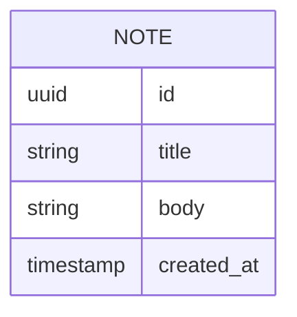

# Data Model Specification

## 1. Entities
### Note
| Field | Type | Required | Constraints | Notes |
|-------|------|----------|-------------|-------|
| id | uuid | yes | PK, generated by the server | |
| title | string | yes | 1 to 120 characters, trimmed | |
| body | string | yes | 0 to 10000 characters | may contain personal data |
| created_at | timestamp (UTC) | yes | set once at creation | drives ordering |

## 2. Relationships (ERD)

## 3. Business rules
| ID | Rule | Enforced at | Traces |
|----|------|-------------|--------|
| BR-001 | Title is required and at most 120 characters | service layer | REQ-001 |
| BR-002 | Notes are ordered by created_at descending, ties broken by id ascending; the pagination cursor encodes the created_at and id of the last returned note, so no note is skipped or repeated | repository | REQ-002 |
| BR-003 | Deletion is permanent (hard delete); deleting a missing note is a not-found outcome and changes nothing | repository | REQ-003 |
| BR-004 | Body is at most 10000 characters (empty allowed) | service layer | REQ-001 |
| BR-005 | Notes are immutable after creation: there is no update operation in this version | service layer | REQ-001 |
| BR-006 | Acknowledged writes are durable across process restarts (NFR-003) | repository | REQ-001 |

## 4. State machines
None: a note has no lifecycle states beyond existing or deleted.

## 5. Indexes, retention, soft-delete policy
Index on created_at descending. No retention limit. No soft delete (see BR-003).

## 6. Data classification
`body` and `title` are user content and may contain personal data. They are never logged (constitution).
