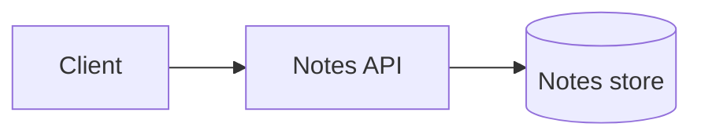

# Architecture

## 1. Context diagram


## 2. Containers / components
| Component | Responsibility | Tech | Owns data |
|-----------|----------------|------|-----------|
| HTTP layer | Routing, validation, error envelope | web framework of choice | no |
| Note service | Business rules BR-001 to BR-003 | plain code | no |
| Note repository | Persistence and ordering | embedded database | Note |

## 3. Key decisions
- ADR-0001: use an embedded database to keep deployment to one process (see `adr/`).

## 4. Repository / file structure
```
src/
  http/      routes and validation
  service/   note rules
  repo/      persistence
tests/
specs/
```

## 5. Cross-cutting concerns
Structured logs without note contents; configuration through environment variables; a single error mapper producing the standard error envelope.

## 6. Deployment topology
One stateless process behind a reverse proxy; the embedded database file lives on a persistent volume.

## 7. Risks and trade-offs
Embedded database limits horizontal scaling; acceptable for the single-user scope (NFR-001 targets 50 requests per second).
