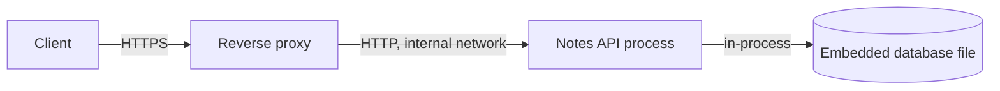

# Architecture

## 1. Context diagram

The reverse proxy terminates TLS and is the only component reachable from outside. The API listens on an internal address only.

## 2. Containers / components
| Component | Responsibility | Tech | Owns data |
|-----------|----------------|------|-----------|
| Reverse proxy | TLS, access control at the network edge | any standard proxy | no |
| HTTP layer | Routing, input validation, mapping errors to the standard error envelope | web framework of choice | no |
| Note service | Business rules BR-001, BR-004, BR-005 (input limits, immutability) | plain code | no |
| Note repository | Persistence, ordering, cursor encoding, hard delete, durability (BR-002, BR-003, BR-006) | embedded database | Note |

Data flow for POST /v1/notes: proxy, HTTP layer (validate), note service (BR-001), repository (insert), back up the chain with 201. GET and DELETE follow the same path; GET uses the repository ordering and cursor, DELETE calls repository delete and maps "no row" to 404.

## 3. Key decisions
- ADR-0001: use an embedded database (see `adr/ADR-0001-embedded-database.md`): one process, durable writes, simple backup; trade-off is no horizontal scaling.

## 4. Repository / file structure
```
src/
  http/      routes, validation, error mapper
  service/   note rules (BR-001 to BR-003)
  repo/      persistence, ordering, cursor encoding
tests/       integration and unit tests (TEST-001 to TEST-006)
specs/       these specifications and adr/
```

## 5. Cross-cutting concerns
- Authentication: none in this version (PRD assumption); protection comes from network placement behind the proxy, see risks.
- Configuration: environment variables only (listen address, database file path); no secrets are needed.
- Logging: structured logs with request id, method, path and status; never note contents (NFR-002).
- Errors: a single error mapper produces the standard envelope for every failure, including unexpected ones (500).

## 6. Deployment topology
- Local development: run the single process with a database file in a temporary folder; no proxy needed.
- Deployed: one stateless API process behind the reverse proxy, on an internal network, database file on a persistent volume that is backed up by copying the file.

## 7. Risks and trade-offs
- No authentication: the service must never be exposed to the public internet. Mitigation: bind to an internal address, accept traffic only from the proxy, and put network-level access control at the proxy. Accepted until a multi-user PRD exists.
- Embedded database limits horizontal scaling: acceptable for the single-user scope (NFR-001 targets 50 requests per second); revisit via a new ADR.
- Single writer: write bursts queue; acceptable at the target load, measured by TEST-004.
