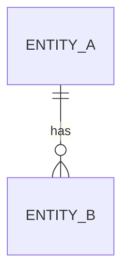

# Data Model Specification

> Instructions for the author (human or AI): replace every {{placeholder}}, delete guidance blockquotes when done, and set `status: approved` only after review.

> Technology-neutral. The data model drives the API and UI.

## 1. Entities
### {{Entity}}
| Field | Type | Required | Constraints | Notes |
|-------|------|----------|-------------|-------|
| id | uuid | yes | PK | |

## 2. Relationships (ERD)

## 3. Business rules
| ID | Rule | Enforced at | Traces |
|----|------|-------------|--------|
| BR-001 | {{}} | {{db/service}} | REQ-001 |

## 4. State machines
{{States, transitions, guards, who may trigger.}}

## 5. Indexes, retention, soft-delete policy
{{}}

## 6. Data classification
See `15-data-governance` for PII fields.
